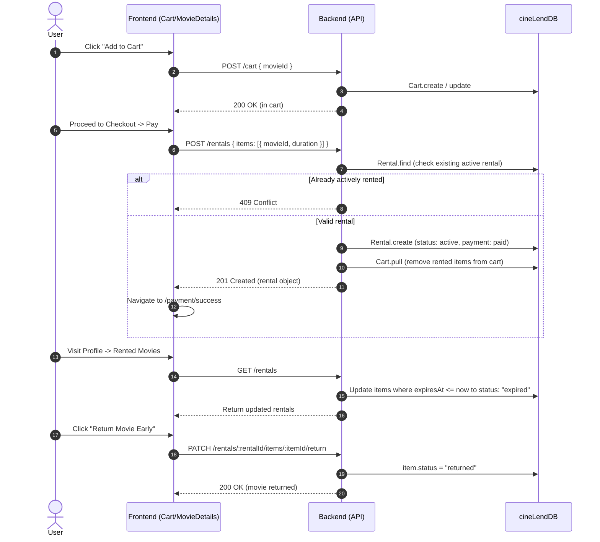
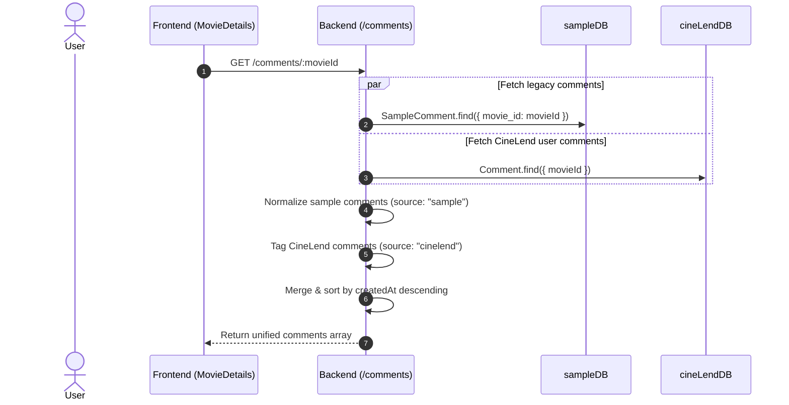

# CineLend — Project Architecture Map

## 1. Executive Overview

**CineLend** is a full-stack movie discovery and rental platform built on a dual-tier architecture:
- **Backend**: Node.js, Express 5, Mongoose 9, JWT authentication, and a custom tiered movie rental pricing engine.
- **Frontend**: React 19, Vite 8, React Router v7, Axios, Swiper, and custom Glassmorphic CSS design system.
- **Database Strategy**: Unique **dual-database MongoDB architecture** separating a read-only catalog (`sampleDB` / `sample_mflix`) from the application database (`cineLendDB`).

---

## 2. Architecture & Dual-Database Strategy

```
                          ┌─────────────────────────┐
                          │   Frontend (React 19)   │
                          │   Vite, React Router 7  │
                          └────────────┬────────────┘
                                       │ HTTP / REST / JWT
                                       ▼
                          ┌─────────────────────────┐
                          │  Backend (Express 5.x)  │
                          │  Auth, Routes, Services │
                          └─────┬─────────────┬─────┘
                                │             │
            Mongoose Connection 1             Mongoose Connection 2
                                │             │
                                ▼             ▼
                     ┌──────────────────┐  ┌──────────────────────┐
                     │     sampleDB     │  │      cineLendDB      │
                     │  (sample_mflix)  │  │ (Application State)  │
                     │──────────────────│  │──────────────────────│
                     │ • movies         │  │ • users              │
                     │ • comments       │  │ • rentals            │
                     │   (legacy seed)  │  │ • carts              │
                     │                  │  │ • collections        │
                     │                  │  │ • collectionmovies   │
                     │                  │  │ • comments (active)  │
                     │                  │  │ • likes              │
                     └──────────────────┘  └──────────────────────┘
```

### Key Architectural Constraint: Cross-Database Separation
Because `sampleDB` and `cineLendDB` are two distinct Mongoose connections (`mongoose.createConnection`), **standard Mongoose `.populate()` cannot be used across databases**.
- Relationships between `Movie` (in `sampleDB`) and CineLend documents (`Rental`, `Cart`, `CollectionMovie`, `Like`, `Comment`) are maintained via `movieId` (`ObjectId`).
- Controllers execute manual two-phase batch queries (e.g. `Movie.find({ _id: { $in: movieIds } })`) and merge data into response objects before sending them to the client.

---

## 3. Directory Structure

```
CinLend/
├── Backend/
│   ├── config/
│   │   └── db.js                       # Dual MongoDB connections (sampleDB, cineLendDB)
│   ├── controllers/
│   │   ├── cartController.js           # Cart add, get, remove, clear
│   │   ├── collectionController.js     # User collections & movie bookmarks
│   │   ├── commentController.js        # Hybrid comment fetching (sample + user)
│   │   ├── likeController.js           # Movie likes and total count aggregations
│   │   ├── movieController.js          # Search, faceted filters, people lookup, recommendations
│   │   ├── rentalController.js         # Rental creation, validation, expiry, return
│   │   └── userController.js           # Registration, login, profile, password, deletion
│   ├── data/
│   │   ├── genres.js                   # Genre list
│   │   └── movies.js                   # Seed/Mock movie objects
│   ├── middleware/
│   │   └── authMiddleware.js           # JWT Bearer token validation
│   ├── models/
│   │   ├── Cart.js                     # User shopping cart schema
│   │   ├── Collection.js               # User-created custom collection schema
│   │   ├── CollectionMovie.js          # Many-to-many collection-to-movie mapping
│   │   ├── Comment.js                  # CineLend user comments
│   │   ├── Like.js                     # User movie likes
│   │   ├── Movie.js                    # Movie schema (sampleDB `movies` collection)
│   │   ├── Rental.js                   # Rental order and active item schema
│   │   ├── SampleComment.js            # Legacy comments (sampleDB `comments` collection)
│   │   └── User.js                     # User identity schema
│   ├── routes/
│   │   ├── cartRoutes.js               # /cart
│   │   ├── collectionRoutes.js         # /collections
│   │   ├── commentRoutes.js            # /comments
│   │   ├── likeRoutes.js               # /likes
│   │   ├── movieRoutes.js              # /movies
│   │   ├── rentalRoutes.js             # /rentals
│   │   └── userRoutes.js               # /users
│   ├── utils/
│   │   └── pricing.js                  # Tiered pricing engine & duration multipliers
│   ├── package.json
│   └── server.js                       # Express app bootstrap & route registration
│
├── Frontend/
│   ├── public/                         # Public assets (Logos, icons.svg, chair.png, placeholder.gif)
│   ├── src/
│   │   ├── assets/                     # Hero banners and branding vectors
│   │   ├── components/
│   │   │   ├── Footer/                 # Universal site footer
│   │   │   ├── HeroSlider/             # Swiper-based home hero movie slider
│   │   │   ├── homemovie/              # MovieRow, MovieCard, HomeMovies sections
│   │   │   ├── Navbar/                 # Sticky glass navbar with theme toggle & user dropdown
│   │   │   ├── OnboardingModal/        # 3-step preference setup (Age & Genres)
│   │   │   ├── Skeleton/               # Universal shimmer loading component
│   │   │   └── Icon.jsx                # SVG sprite symbol helper
│   │   ├── constants/
│   │   │   └── discover.js             # Default filter state, sort options, rating ranges
│   │   ├── context/
│   │   │   ├── AuthContext.jsx         # User auth, JWT token, rememberMe (local vs session)
│   │   │   └── ThemeContext.jsx        # Dark/Light theme class toggle & persistence
│   │   ├── data/                       # Frontend local fallback mock data
│   │   ├── hooks/
│   │   │   └── useDebounce.js          # Generic debounce hook for search and range sliders
│   │   ├── pages/
│   │   │   ├── About/                  # Platform overview & tech stack documentation
│   │   │   ├── Cart/                   # Cart overview & duration selection panel (RentalPanel)
│   │   │   ├── Checkout/               # Rental review and order summary
│   │   │   ├── Discover/               # Faceted search, sidebar filters, sorting, pagination
│   │   │   ├── Home.jsx                # Landing page (HeroSlider + curated rows)
│   │   │   ├── Login/                  # User authentication with redirect support
│   │   │   ├── MovieDetails/           # In-depth movie view, cast, awards, hero actions, comments
│   │   │   ├── Payment/                # Simulated demo payment checkout screen
│   │   │   ├── PaymentSuccess/         # Post-rental confirmation and receipt view
│   │   │   ├── Profile/                # User dashboard (Rentals, Collections, Comments, Settings)
│   │   │   └── Register/               # User registration screen
│   │   ├── routes/
│   │   │   └── router.jsx              # React Router browser routing configuration
│   │   ├── services/
│   │   │   └── discoverService.js      # Axios client for movie discovery and search endpoints
│   │   ├── App.jsx                     # Layout wrapper (Navbar, OnboardingModal, Outlet, Footer)
│   │   ├── main.jsx                    # Root rendering with ThemeProvider & AuthProvider
│   │   └── index.css                   # Global styling, tokens, and CSS variables
│   ├── package.json
│   ├── vercel.json                     # SPA client-side rewrite configuration
│   └── vite.config.js                  # Vite configuration with React plugin
├── AI_AUDIT.md                         # Continuous system audit and issue tracking
├── PROJECT_MAP.md                      # Architecture documentation (this file)
└── README.md                           # Repository introduction
```

---

## 4. Backend Architecture Details

### 4.1 Database Models & Schemas

| Model | Database | Collection | Key Fields | Purpose |
|---|---|---|---|---|
| `User` | `cineLendDB` | `users` | `name`, `email` (unique), `password` (bcrypt), `profileImage` | User account identity |
| `Movie` | `sampleDB` | `movies` | `title`, `fullplot`, `year`, `released`, `genres`, `imdb`, `tomatoes`, `runtime`, `cast`, `directors`, `writers`, `poster` | Master movie catalog |
| `Rental` | `cineLendDB` | `rentals` | `userId`, `items` (embedded subdocs), `totalPrice`, `paymentStatus`, `paymentMethod` | Completed rental transactions |
| `Rental.items` | Embedded | - | `movieId`, `title`, `durationType`, `durationDays`, `price`, `rentedAt`, `expiresAt`, `status` (`active`, `returned`, `expired`) | Line items within rental |
| `Cart` | `cineLendDB` | `carts` | `userId` (unique), `items: [{ movieId }]` | Active user cart items |
| `Collection` | `cineLendDB` | `collections` | `userId`, `name`, `description` (compound index on `[userId, name]`) | Custom user folders / watchlists |
| `CollectionMovie` | `cineLendDB` | `collectionmovies`| `collectionId`, `movieId` (compound index on `[collectionId, movieId]`) | Many-to-many movie bookmark |
| `Comment` | `cineLendDB` | `comments` | `userId`, `name`, `movieId`, `text`, `rating` (1-5) | User-generated reviews |
| `SampleComment` | `sampleDB` | `comments` | `name`, `email`, `movie_id`, `text`, `date` | Legacy seed comments |
| `Like` | `cineLendDB` | `likes` | `userId`, `movieId` (compound unique index) | Movie upvotes |

### 4.2 Pricing Engine (`Backend/utils/pricing.js`)

Pricing is determined dynamically based on the film's **Release Year** and the chosen **Rental Duration Package**:

#### Pricing Tiers
- **Classic**: `<= 1925` → Base ₹1.00 / day
- **Vintage**: `1926 – 1955` → Base ₹1.50 / day
- **Modern**: `1956 – 1985` → Base ₹2.00 / day
- **Recent**: `>= 1986` → Base ₹3.00 / day

#### Rental Duration Packages
- **1 Day**: `1 day` | Multiplier = `1`
- **1 Week**: `7 days` | Multiplier = `6` *(1 day discount)*
- **1 Month**: `30 days` | Multiplier = `23` *(7 days discount)*
- **3 Months**: `90 days` | Multiplier = `75` *(15 days discount)*
- **6 Months**: `180 days` | Multiplier = `150` *(30 days discount)*
- **1 Year**: `365 days` | Multiplier = `300` *(65 days discount)*
- **Custom**: `N days` | Formula = `baseDailyPrice * N`

---

## 5. Backend REST API Reference

| Method | Endpoint | Auth | Controller Method | Description |
|---|---|---|---|---|
| **Users** | | | | |
| `POST` | `/users` | Public | `createUser` | Register user account |
| `POST` | `/users/login` | Public | `loginUser` | Authenticate user & issue JWT |
| `GET` | `/users/me` | Bearer | `getCurrentUser` | Fetch logged-in user profile |
| `PUT` | `/users/me` | Bearer | `updateProfile` | Update name, email, profile image |
| `PUT` | `/users/me/password` | Bearer | `changePassword` | Change current password |
| `DELETE` | `/users/me` | Bearer | `deleteAccount` | Delete user and all associated records |
| **Movies** | | | | |
| `GET` | `/movies` | Public | `getMovies` | Advanced search, faceted filter, sort, paginate |
| `GET` | `/movies/filters` | Public | `getFilters` | Aggregate unique genres, languages, countries, ratings |
| `GET` | `/movies/people` | Public | `getPeople` | Autocomplete/search cast, directors, or writers |
| `GET` | `/movies/recent` | Public | `getRecentMovies` | Top 10 recent movies for Hero Slider |
| `GET` | `/movies/genres` | Public | `getGenres` | List of all available genre tags |
| `GET` | `/movies/:id` | Public | `getMovieById` | Complete movie details by ID |
| `GET` | `/movies/:id/pricing` | Public | `getMoviePricing` | Pricing tier & duration package calculation |
| `GET` | `/movies/related/:id` | Public | `getRelatedMovies` | Genre-overlap recommendation algorithm |
| **Cart** | | | | |
| `GET` | `/cart` | Bearer | `getCart` | Fetch current user's cart |
| `POST` | `/cart` | Bearer | `addToCart` | Add movie ID to cart |
| `DELETE` | `/cart/:movieId` | Bearer | `removeFromCart` | Remove specific movie from cart |
| `DELETE` | `/cart` | Bearer | `clearCart` | Clear all items from cart |
| **Rentals** | | | | |
| `POST` | `/rentals` | Bearer | `createRental` | Place rental order, validate conflicts, purge from cart |
| `GET` | `/rentals` | Bearer | `getMyRentals` | Fetch user rental history & update expired statuses |
| `PATCH`| `/rentals/:rentalId/items/:itemId/return` | Bearer | `returnRentalMovie` | Mark active rental item as returned |
| **Collections** | | | | |
| `POST` | `/collections` | Bearer | `createCollection` | Create a new user collection |
| `GET` | `/collections` | Bearer | `getUserCollections` | List user collections (with `containsMovie` check) |
| `GET` | `/collections/:collectionId` | Bearer | `getCollection` | Fetch collection details and member movies |
| `PUT` | `/collections/:collectionId` | Bearer | `updateCollection` | Update collection name and description |
| `DELETE`| `/collections/:collectionId` | Bearer | `deleteCollection` | Delete collection and its member mappings |
| `POST` | `/collections/:collectionId/movies` | Bearer | `addMovieToCollection` | Add movie to collection |
| `DELETE`| `/collections/:collectionId/movies/:movieId` | Bearer | `removeMovieFromCollection` | Remove movie from collection |
| **Comments** | | | | |
| `POST` | `/comments` | Bearer | `createComment` | Post comment with optional 1–5 rating |
| `GET` | `/comments/:movieId` | Public | `getMovieComments` | Fetch merged comments (`sampleDB` + `cineLendDB`) |
| `GET` | `/comments/mine` | Bearer | `getMyComments` | Fetch user's own comments with populated movie details |
| **Likes** | | | | |
| `GET` | `/likes/:movieId/count` | Public | `getMovieLikeCount` | Total upvotes count for a movie |
| `GET` | `/likes/:movieId/status`| Bearer | `getMovieLikeStatus` | Check if user liked a movie + total count |
| `POST` | `/likes` | Bearer | `likeMovie` | Upvote a movie |
| `DELETE`| `/likes/:movieId` | Bearer | `unlikeMovie` | Remove upvote from a movie |
| `GET` | `/likes` | Bearer | `getMyLikes` | Fetch all movies liked by user |

---

## 6. Frontend Architecture Details

### 6.1 Routing Hierarchy

```
<RouterProvider router={router}>
  ├── / (App layout with Navbar, OnboardingModal, Footer)
  │    ├── index (Home: HeroSlider + Curated Movie Rows)
  │    ├── discover (Discover: Faceted Search & Filters)
  │    ├── movie/:id (MovieDetails: Hero, Overview, Cast, Awards, Comments, Related)
  │    ├── about (About: Project info)
  │    ├── profile (Profile: Overview, Rented, Collections, Comments, Settings)
  │    ├── cart (Cart: Cart items & RentalPanel modal)
  │    └── checkout (Checkout: Review order summary)
  │
  ├── /login (Stand-alone auth layout with cinema backdrop)
  ├── /register (Stand-alone registration layout)
  ├── /payment (Demo payment simulation screen)
  └── /payment/success (Confirmation & digital receipt view)
```

### 6.2 Context & Global State

1. **`AuthContext` (`Frontend/src/context/AuthContext.jsx`)**:
   - Manages `{ user, token }`.
   - Supports **Remember Me**:
     - `rememberMe === true`: Stored in `localStorage`.
     - `rememberMe === false`: Stored in `sessionStorage`.
   - Methods: `login(userData, token, rememberMe)`, `logout()`, `updateUser(updatedUser)`.

2. **`ThemeContext` (`Frontend/src/context/ThemeContext.jsx`)**:
   - Manages `{ darkMode, setDarkMode }`.
   - Persists state in `localStorage.getItem("theme")`.
   - Directly toggles the CSS `.dark` class on `document.body`.

### 6.3 Page & Feature Decomposition

1. **Home (`/`)**:
   - `HeroSlider`: Full-width hero carousel powered by Swiper; fetches `/movies/recent`.
   - `HomeMovies`: 5 curated horizontal scroll rows (`Top Streaming`, `Trending Now`, `Top Rated`, `Recommended For You`, `Try Something New`).
   - Uses preferences saved in `localStorage.getItem("pref")` to tailor recommended rows.

2. **Discover (`/discover`)**:
   - Fully faceted query engine synced bidirectionally with URL search parameters.
   - Filters: Multiple genres, languages, content ratings, countries, dual-thumb range sliders for IMDb rating, release year, runtime, and autocomplete person search (cast, directors, writers).
   - Server-side sorting (`recent`, `rating`, `title`, `random`) and pagination.
   - Skeletons and debounced query execution.

3. **Movie Details (`/movie/:id`)**:
   - `MovieHero`: Dynamic backdrop, poster, rating, runtime, dynamic pricing calculation preview, Cart toggle, Collection bookmarking, and Like button with real-time counter.
   - `MovieOverview`, `MovieAbout`, `MovieCastCrew`, `MovieAwardsFacts`.
   - `MovieComments`: Real-time commenting with rating stars and deep-linking support (`?comment=<id>`).
   - `RelatedMovies`: Weighted genre-intersection recommendation list.

4. **Cart (`/cart`) & RentalPanel**:
   - Shows all movies added to cart.
   - Individual or bulk rental duration selection via sliding `RentalPanel`.
   - Selects from 6 preset packages or custom day duration with price recalculation.

5. **Checkout (`/checkout`) & Payment (`/payment`)**:
   - Order breakdown with movie details, duration tags, and total price.
   - Mock demo payment transaction sending structured rental payloads to backend.

6. **Profile (`/profile`)**:
   - Dashboard divided into 5 views:
     - **Overview**: Library statistics, active rentals quick-glance, next expiring rental countdown.
     - **Rented Movies**: Active rentals with remaining days and early return action; rental history.
     - **Collections**: User-curated custom playlists and bookmarks.
     - **My Comments**: History of user reviews with direct jump-to-comment links.
     - **Account Settings**: Name/email update, password change, and multi-step account deletion.

---

## 7. Key Data Flows

### 7.1 Rental Lifecycle Flow



### 7.2 Hybrid Dual-Source Comments Flow



